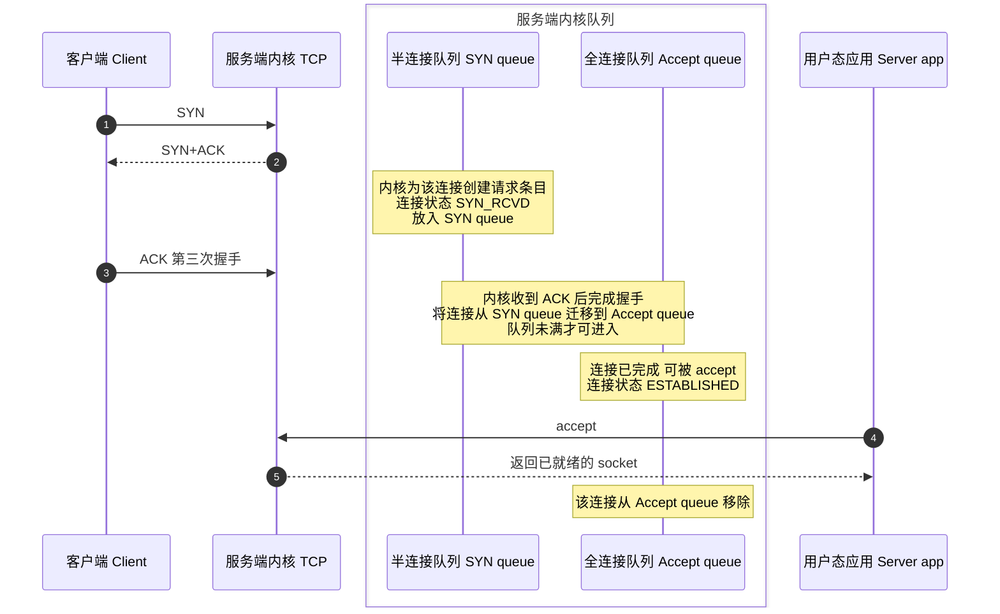
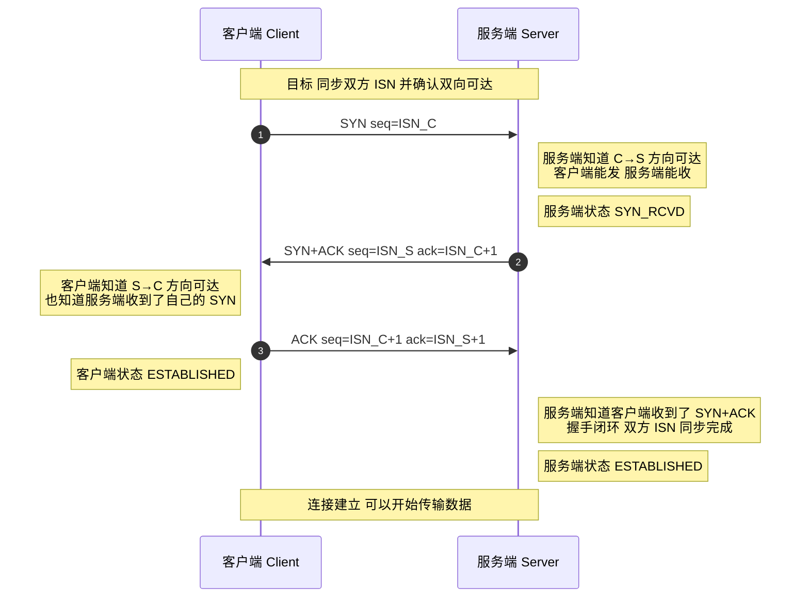

TCP 三次握手和四次挥手很容易被背成一张流程图：客户端发 `SYN`，服务端回 `SYN+ACK`，最后再来一个 `ACK`；关闭连接时，再按 `FIN`、`ACK`、`FIN`、`ACK` 走一遍。

但真正排查网络问题、看抓包或者聊面试题时，只记顺序往往不够。比如：为什么建立连接不是两次握手？服务端收到第三次握手之后，连接到底放在哪个队列？四次挥手中的 ACK 和 FIN 为什么通常分开发？又在什么条件下能合并成三次挥手？

这篇文章就围绕 TCP 连接的建立和释放，把这些问题串起来讲清楚：

1. TCP 三次握手每一步分别做了什么？
2. 为什么建立连接需要三次握手，而不是两次或四次？
3. 半连接队列和全连接队列分别保存什么？
4. TCP 四次挥手每一步分别做了什么？
5. `TIME_WAIT`、`CLOSE_WAIT`、三次挥手这些细节该怎么理解？
> **术语约定**：本文正文统一使用 `SYN_RCVD`、`TIME_WAIT` 这类下划线写法；RFC 中常写作 `SYN-RECEIVED`、`TIME-WAIT`，Linux `ss` 命令中常显示为 `syn-recv`、`time-wait`。它们指向的是同一类 TCP 状态，只是不同语境下的写法不同。

## 建立连接：TCP 三次握手
![[TCP三次握手，四次挥手-1792029670545.webp]]
在最常见的“一端主动发起连接、一端被动监听”的场景下，TCP 连接通常通过三次握手建立：

1. **第一次握手（SYN）**：客户端向服务端发送一个 SYN（Synchronize Sequence Numbers）报文段，其中包含客户端生成的初始序列号（Initial Sequence Number，ISN），例如 `seq=x`。发送后，客户端进入 `SYN_SENT` 状态，等待服务端确认。
2. **第二次握手（SYN+ACK）**：服务端收到 SYN 后，如果同意建立连接，会回复一个 SYN+ACK 报文段。这个报文段包含两个关键信息：
   - **SYN**：服务端也需要同步自己的初始序列号，因此会携带服务端生成的 ISN，例如 `seq=y`。
   - **ACK**：用于确认收到客户端的 SYN，确认号设置为客户端初始序列号加一，即 `ack=x+1`。
   - 发送该报文段后，服务端进入 `SYN_RCVD` 状态。
3. **第三次握手（ACK）**：客户端收到服务端的 SYN+ACK 后，会向服务端发送最终确认报文段。由于客户端的 SYN 会消耗一个序列号，因此这个 ACK 报文段的序列号通常为 `seq=x+1`；它用于确认服务端的 SYN，确认号为 `ack=y+1`。发送后，客户端进入 `ESTABLISHED` 状态。服务端收到这个 ACK 后，也进入 `ESTABLISHED` 状态。

至此，双方完成初始序列号同步，并确认这条连接可以开始双向传输数据。
### 什么是半连接队列和全连接队列？

在 TCP 三次握手过程中，服务端内核通常会用两个队列来管理连接请求。下面以常见 Linux 行为为例，不同操作系统、内核版本、socket 选项和部署环境可能会有细节差异。

1. **半连接队列（SYN Queue）**：
   - 保存“握手未完成”的请求。服务端收到 SYN 并回复 SYN+ACK 后，连接进入 `SYN_RCVD`，等待客户端最终 ACK。
   - 如果一直收不到 ACK，内核会按重传策略重发 SYN+ACK，最终超时清理。
   - 常见相关参数包括 `net.ipv4.tcp_max_syn_backlog`。在 SYN Flood 场景下，还会涉及 `net.ipv4.tcp_syncookies`。
2. **全连接队列（Accept Queue）**：

   - 保存“握手已完成但应用还没有 accept”的连接。服务端收到最终 ACK 后，连接变为 `ESTABLISHED`，并进入全连接队列，等待应用层 `accept()` 取走。
   - 队列容量受 `listen(fd, backlog)` 和系统上限 `net.core.somaxconn` 共同影响。实践中常见有效上限可以近似理解为 `min(backlog, somaxconn)`，具体行为仍要看内核版本和应用配置。

总结一下：

| 队列                       | 作用                                   | 状态          | 移出条件                 |
| -------------------------- | -------------------------------------- | ------------- | ------------------------ |
| 半连接队列（SYN Queue）    | 保存未完成握手的连接                   | `SYN_RCVD`    | 收到 ACK / 超时重传失败  |
| 全连接队列（Accept Queue） | 保存已完成握手、等待应用 accept 的连接 | `ESTABLISHED` | 被应用层 `accept()` 取出 |

当全连接队列满时，`net.ipv4.tcp_abort_on_overflow` 会影响处理策略：

- `0`（默认）：Linux 通常不会立即返回 RST，而可能丢弃第三次握手 ACK，使服务端继续停留在握手未完全完成的状态，并重传 SYN+ACK。客户端发出第三次 ACK 后，通常已经认为 `connect()` 成功；但服务端并没有把这个连接放进全连接队列，所以客户端后续发送数据时可能迟迟得不到正常响应，最终表现为首包阻塞、读超时或重试。
- `1`：直接对客户端回复 `RST`，让连接快速失败。

排查时可以用 `ss -ltn` 看监听 socket。对于 `LISTEN` 状态，`Recv-Q` 通常表示当前 backlog 中等待应用 accept 的连接数，`Send-Q` 表示 socket backlog 上限。如果 `Recv-Q` 长时间接近 `Send-Q`，就要重点怀疑应用 accept 不及时、backlog 偏小、线程池卡住、GC 抖动或者短时间连接突刺。

当半连接队列满时，如果 `tcp_syncookies=1`，Linux 会在 SYN backlog 溢出时启用 SYN Cookie：服务端把必要信息编码进返回的 SYN+ACK 中，而不是为每个请求都保留完整的半连接状态。也就是说，SYN Cookie 生效时，服务端不会为这个 SYN 在半连接队列中分配常规状态；只有收到合法的最终 ACK 后，内核才会校验 cookie，并重建连接所需的信息。

但 SYN Cookie 是防护手段，不是扩容手段。它能缓解 SYN Flood 对半连接队列的冲击，但仍会消耗 CPU；如果攻击流量已经打满带宽，SYN Cookie 也无法从根本上恢复可用性。另外，SYN Cookie 模式下部分 TCP 扩展能力可能受限，在高延迟、高带宽链路下可能出现性能退化。`tcp_syncookies=2` 更偏测试用途，不建议作为生产环境默认配置。

### 为什么要三次握手？

TCP 三次握手主要做两件事：**同步双方的初始序列号**，并且**确认双方的收发路径是可用的**。真正的数据可靠交付，还要依赖后续传输过程中的确认、重传、窗口控制和拥塞控制。

#### 1. 确认双方收发能力，并同步初始序列号

TCP 依赖序列号（SEQ）和确认号（ACK）来保证数据有序、去重和重传。三次握手通过交换并确认双方的 ISN，让两端对“从哪个序号开始收发数据”达成一致，同时避免只凭单向信息就进入已建立状态。

可以用下面这张表来记：

| 步骤 | 报文         | 能确认什么                                                             |
| ---- | ------------ | ---------------------------------------------------------------------- |
| 1    | C→S：SYN     | 服务端知道：客户端能发，服务端能收，C→S 方向可达                       |
| 2    | S→C：SYN+ACK | 客户端知道：服务端能发，客户端能收；同时确认服务端收到了自己的 SYN     |
| 3    | C→S：ACK     | 服务端知道：客户端收到了 SYN+ACK，S→C 方向也被服务端确认；至此握手闭环 |

注意：第 2 步完成时，只有客户端确认了双向可达；服务端此时还不知道自己发出的 SYN+ACK 是否被客户端收到。服务端只有收到第 3 次握手的 ACK 后，才真正确认这个闭环，这也是两次握手不够的核心原因。