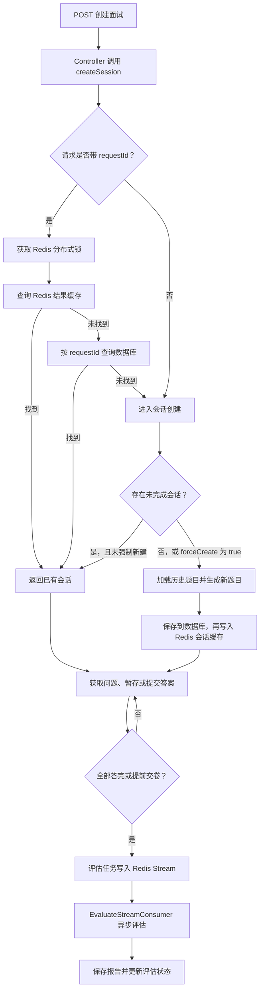
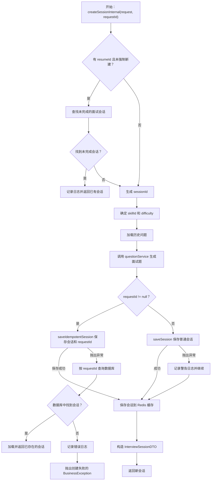
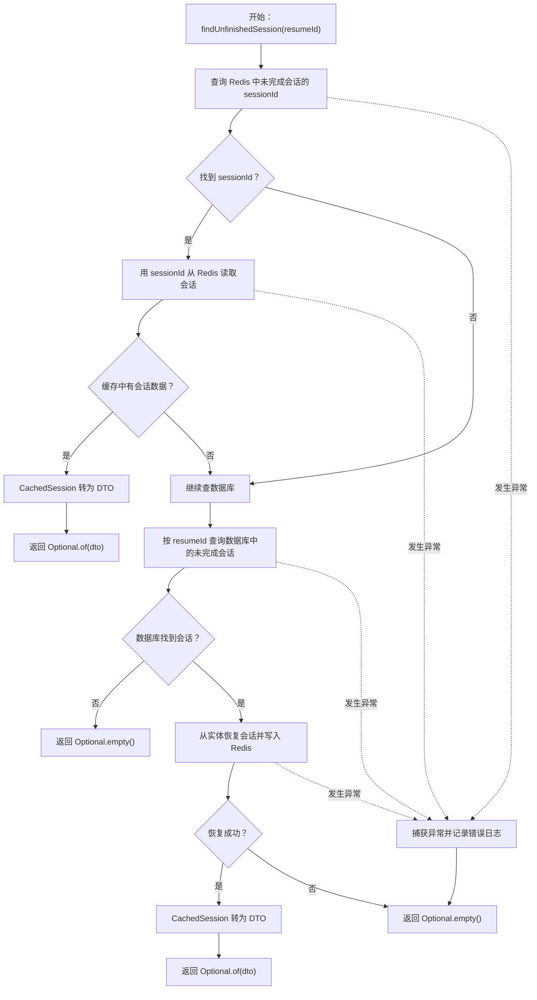
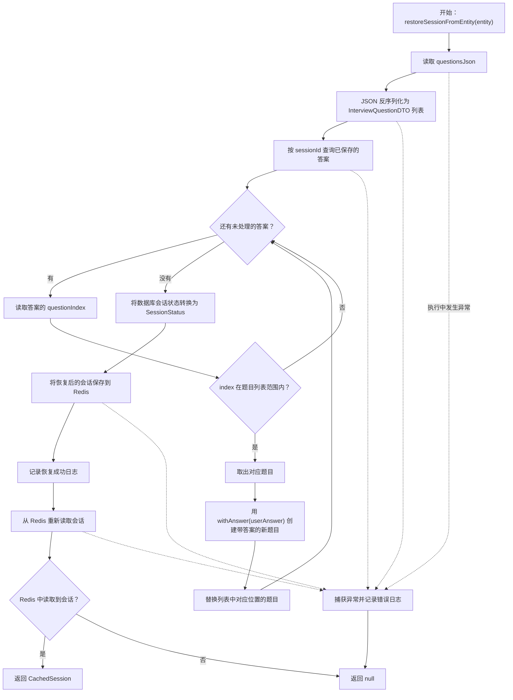

---
summary:
tags:
created: 2026-11-16
updated: 2026-11-16
---

# 简易总体流程图

# createSessionInternal

这个函数调用了
查找未完成：
[[#findUnfinishedSession]]
生成问题：
[[questionService#generateQuestionsBySkill]]
数据层保存会话，Redis保存会话这些不作详细介绍可以自己看一下
不过这里还是有必要说一下requestId是否为null时的保存
他们最后调用的方法都是同一个方法

# findUnfinishedSession

这个函数的简单思想就是从redis中查找，如果有直接转换并返回没有从数据库中查找，如果有则先从实体恢复会话且写入Redis，如果恢复成功则返回CachSession（是缓存的实体），这里使用的方法有restoreSessionFromEntity
# restoreSessionFromEntity恢复操作

解析问题使用objectMapper
查询问题之类的就使用的是数据库的相关操作，保存到Redis使用saveSession，保存到Redis就从中获取CachedSession