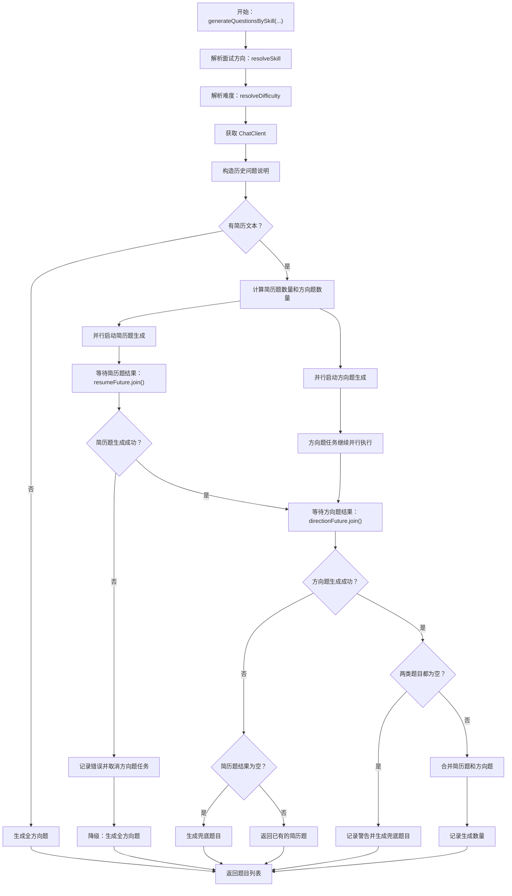
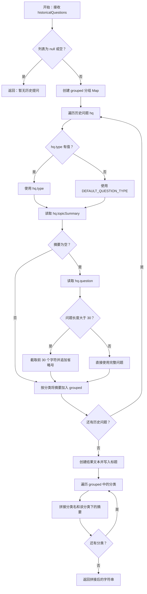
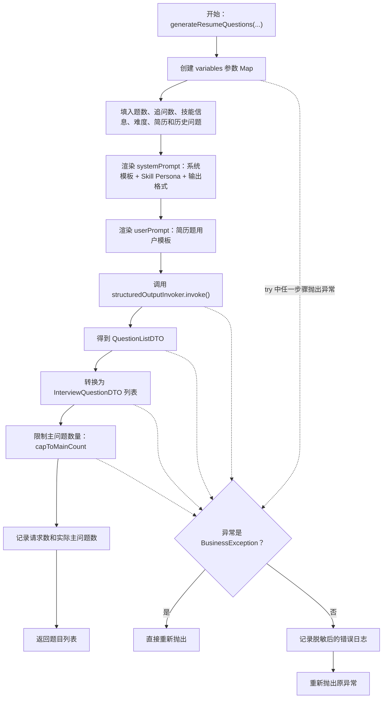
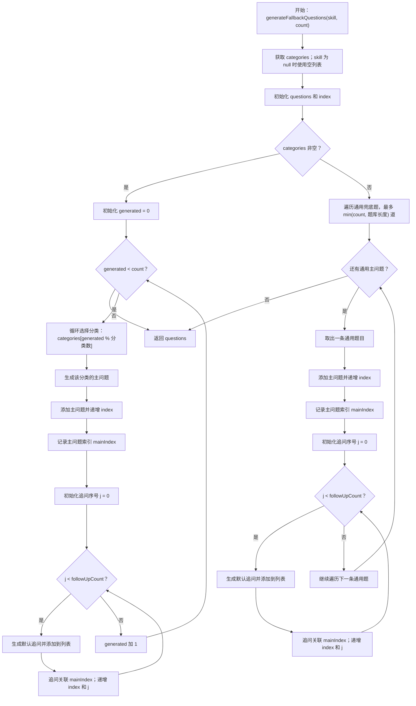

---
summary:
tags:
created: 2026-11-16
updated: 2026-11-16
---
# generateQuestionsBySkill

使用到的一些函数
[[#buildHistoricalSection]]
[[#generateResumeQuestions生成简历题]]
[[#generateDirectionOnly生成全方位题]]
[[#generateFallbackQuestions生成默认兜底题]]
如果简历题和全方位题目都不为空就会使用合并简历的方法
# buildHistoricalSection

# generateDirectionOnly生成全方位题

# generateResumeQuestions生成简历题

# generateFallbackQuestions生成默认兜底题

