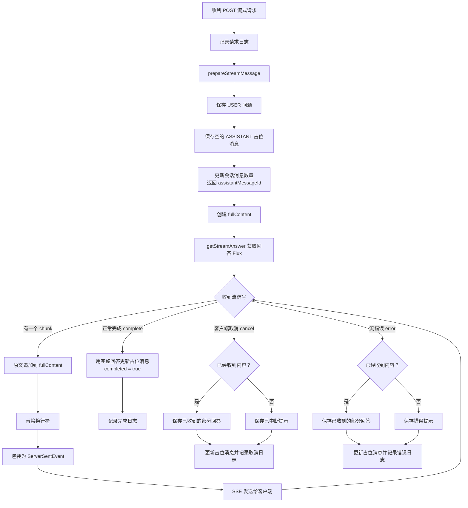

---
summary:
tags:
created: 2026-11-19
updated: 2026-11-21
---
相关网址：

相关笔记：
[[SSE、Flux流式响应]]

---

# 创建对话
使用到了[[RagChatSessionService#createSession]]
# sendMessageStream
这个函数的步骤可以分为三步：
1.同步保存用户消息和创建AI消息占位
2.返回流式响应
3.流式完成后通过回调更新消息

准备消息则使用到了[[RagChatSessionService#prepareStreamMessage]]
获取流式响应调用了上面类中的getStreamAnser方法，这个方法首先会判断会话是否存在（不存在会抛出异常），
注意！！！这里会可能获取历史的信息（这就与[[konwledgeBaseQueryService#anserQuestion]]不同了，因为可以看到这个函数的history基本全是空集合，但是使用流式响应的时候却可以获取历史记录(从messagRepository中操作)
然后就用[[konwledgeBaseQueryService#anserQuestionStream]]参数是kbIds、question、history
如果想要了解代码中的各种doOnComplete等链式调用可以参考网站：[Flux流式响应详解 - DeepSeek](https://chat.deepseek.com/a/chat/s/c568cefb-daab-4739-ae7b-6449757db67f)（当然这是我自己的DeepSeek，如果你搞不懂的话也可以按照响应的关键词询问AI)
最后要包装成**ServerSentEvent**返回给前端
## RAG问答优化：多轮上下文与短查询命中修复
### RAG问答无状态
RagChatSessionService虽然把每轮对话都存入数据库，但是getStreamAnser调用只上传了知识库ID和当前位置（当然，这个问题已经解决了），不加载历史，每次提问都是独立的一次检索生成，LLM完全不知道之前聊了啥
这里还有一些问题比如：
1.注入历史信息chatClient提供.messages()方法，可以传入List\<Message>作为对话历史，所以可以从数据库中获取之前的会话记录，然后传给ChatClient
2.加载历史信息如果不排除自己的信息，其查询条件是查询数据库中状态为完成并且SessionId为对应Id的信息。所以需要排除自己当轮的user消息
```java
  List<RagChatMessageEntity> historyMessages = recent.size() <= 1
        ? List.of()
        : recent.subList(1, recent.size());
```
3.不加载全部信息，使用Pageable分页查询（不用limit因为它是SQL的方言,Spring Data的pageable是JPA的标准分页方式）
4.在搜索RAG知识库的时候也要进行问题重写，我向RAG询问“那它呢”这个它就是毫无检索信息的文本，让LLM替换可以得到更好的问题
### 短查询被字面匹配误杀
`KnowledgeBaseQueryService` 有一个 `hasEffectiveHit` 方法，对短查询（如"JVM"、"Redis"）做了一层额外的字面确认：先用 `contains()` 检查检索到的文档里是否包含查询词的字面文本，匹配不到就视为无效结果，全部丢弃。这个逻辑的初衷是合理的。短查询的 embedding 区分度低，容易召回弱相关内容，加一层字面确认可以降低误召回。但问题在于，字面匹配和语义匹配是两套不同的相似度体系，中文场景下同义替换非常普遍：
这里使用的解决办法非常暴力，去掉字面确认，信任向量阈值，hasEffectiveHit简化为只检查非空，删除所有的字面匹配逻辑去掉字面确认后，短查询的质量保障完全依赖向量检索阶段。当前的 `resolveSearchParams` 方法按查询长度分三档检索参数
```java
// KnowledgeBaseQueryService.java
private SearchParams resolveSearchParams(String question) {
    int compactLength = question.replaceAll("\\s+", "").length();
    if (compactLength <= shortQueryLength) {     // ≤ 4 字符（默认）
        return new SearchParams(topkShort, minScoreShort);   // topK=20, 更低阈值
    }
    if (compactLength <= 12) {                    // 5-12 字符
        return new SearchParams(topkMedium, minScoreDefault); // topK=12
    }
    return new SearchParams(topkLong, minScoreDefault);       // > 12 字符, topK=8
}
```
topK标识向量检索时最多返回多少条最相关的文档片段。TopK大召回内容比较多，漏掉关键消息的概率比较小但是会导致Prompt更长
### 性能方面
三个点，都是在实际使用中踩过之后加的：（这个是guide哥文档里面的）
1. **有界查询**：没有加载全部消息再在 Java 里截断，而是在 Repository 层用了带 `Pageable` 参数的 `findRecentCompletedBySessionId`，只取最近 N+1 条已完成消息。长对话可能有上百条消息，AI 回复的 TEXT 列很大，全量加载既浪费数据库 I/O 又浪费堆内存
2. **功能开关前置**：`history.enabled` 的检查放在 `getStreamAnswer` 里，在调用 `loadHistoryMessages` 之前就判断。功能关闭时不触发任何数据库查询
3. **重写 prompt 中的截断**：`formatHistoryForRewrite` 把助手回复截断到 200 字。重写 prompt 的 LLM 调用本身是轻量的（单次 `call()`，输出只有一行），截断对精度影响很小，但能避免 prompt 过长导致额外的 token 消耗