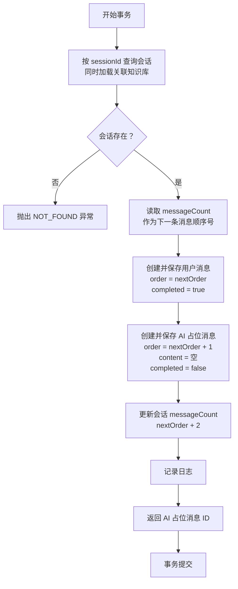

# createSession
分为两个阶段，第一步验证知识库是否存在，使用knowledgeBaseIds茶渣奥数据库种是否有对应的知识库
如果查到的数据库的大小不等于ids的多少就抛异常
之后创建会话实体，最后使用了Mapper转换DTO

# prepareStreamMessage
准备流式消息

开始流式问答前，先将用户问题和一个空的AI消息占位写入数据库，然后返回AI消息的ID，供后续流式生成时更新它
int nextOrder = session.getMessageCount();通常一轮会回答两条信息，一条用户信息，一条AI信息例如当前 
如`messageCount = 6`，新用户消息顺序号是 `6`，AI 消息顺序号是 `7`，更新后的数量是 `8`。
`save` 后重新赋值是为了拿到保存后实体的 ID
两条信息”指**一轮问答里的两条聊天消息**，用户消息是指用户提出的问题，AI消息是先创建一条空的占位消息
这里的准备流式消息最后返回的值就是AI聊天实体的ID值（用于后续找到AI聊天对话然后标记完成之类的）
# completeStreamMessage
流式相应完成后更新消息
这个方法负责把之前创建的**空 AI 占位消息**填上最终回答，并标记为完成。
首先根据ID找到对应的AI信息，找不到就抛出信息不存在业务一次导航，找到后将完整答案写入content，将completed设为true，最后保存