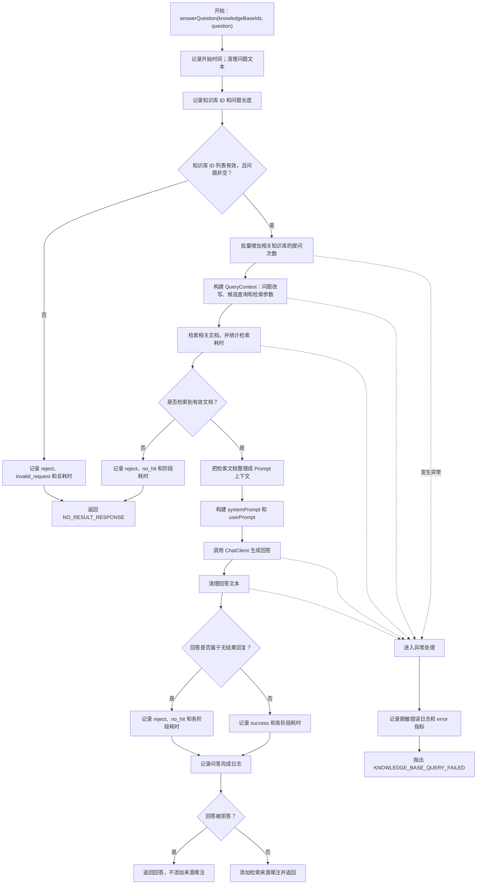

---
summary:
tags:
created: 2026-11-17
updated: 2026-11-17
---
# anserQuestion

先清理并校验问题和知识库 ID，更新提问次数，再改写问题并检索相关知识库片段；没有有效命中时记录拒答指标并返回固定提示，有命中时则把片段作为上下文交给大模型生成回答，规范化结果后附上来源说明。整个过程会记录请求结果和阶段耗时；发生异常时记录日志并统一抛出知识库查询失败异常。
这个函数的流程在文中展现的还是比较清楚的，但是还是自己总结一下比较好。
结合代码再次说一下这个函数的过程：
**首先**计时并第一次清理问题（这里主要是去除问题中的空格）进行简单的清洗。如果konwledgeIds为空就记录然后返回没答案的结果。**其次**批量更新每个数据库的提问次数，并重新构建问题的内容（这里使用到了LLM）并根据重新生成的问题得到相关的有效文档。**接着**把检索到的文章变为String类型，然后构建到UserPrompt中。构建完成systemPrompt还有user内容后调用LM生成回答，之后会清理文本（这里会清除空格这些基本的，也会对包含各种没找到相关信息的回答进行变更，返回标准回答）**最后**根据答案是否是标准拒绝回答得到变量rejected，如果是拒绝就记录reject、no_hit和各阶段耗时，如果成功则记录成功和各阶段耗时。最后根据是否被拒绝返回是否添加检索来源尾注