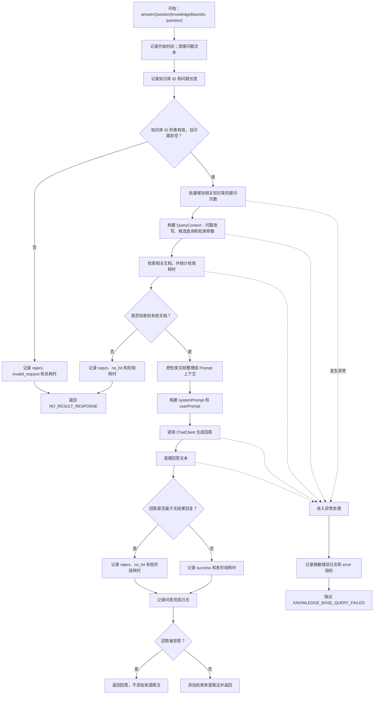
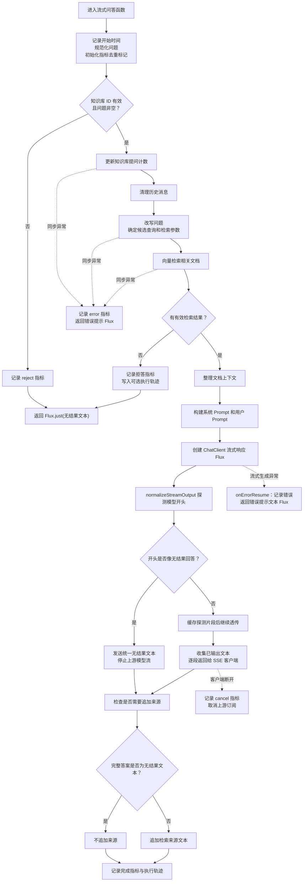
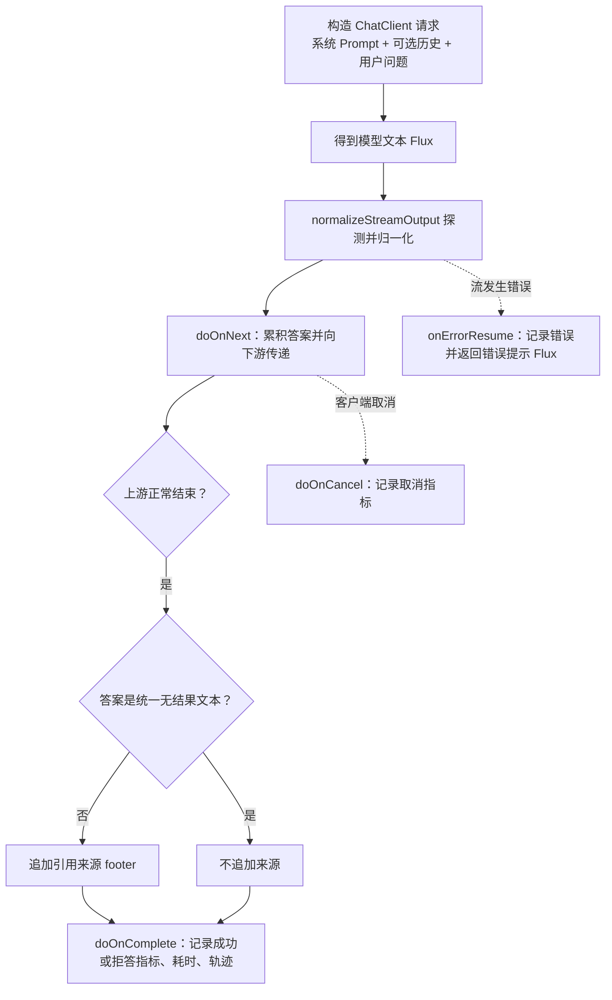

---
summary:
tags:
created: 2026-11-17
updated: 2026-11-17
---
# anserQuestion

先清理并校验问题和知识库 ID，更新提问次数，再改写问题并检索相关知识库片段；没有有效命中时记录拒答指标并返回固定提示，有命中时则把片段作为上下文交给大模型生成回答，规范化结果后附上来源说明。整个过程会记录请求结果和阶段耗时；发生异常时记录日志并统一抛出知识库查询失败异常。
这个函数的流程在文中展现的还是比较清楚的，但是还是自己总结一下比较好。
结合代码再次说一下这个函数的过程：
**首先**计时并第一次清理问题（这里主要是去除问题中的空格）进行简单的清洗。如果konwledgeIds为空就记录然后返回没答案的结果。**其次**批量更新每个数据库的提问次数，并重新构建问题的内容（这里使用到了LLM）并根据重新生成的问题得到相关的有效文档。**接着**把检索到的文章变为String类型，然后构建到UserPrompt中。构建完成systemPrompt还有user内容后调用LM生成回答，之后会清理文本（这里会清除空格这些基本的，也会对包含各种没找到相关信息的回答进行变更，返回标准回答）**最后**根据答案是否是标准拒绝回答得到变量rejected，如果是拒绝就记录reject、no_hit和各阶段耗时，如果成功则记录成功和各阶段耗时。最后根据是否被拒绝返回是否添加检索来源尾注

RagSources中的context处理doc文档，其实拼接内容只要用documents.get(i).getText就好了，但是这个操作还进行了别的拼接操作，比如介绍了结果的文本来自哪等。

`RagMetrics`是项目里专门记录 **RAG 知识库问答运行情况**的封装类。它统计请求结果、各处理阶段耗时、检索命中数量、改写回退次数和拒答次数，方便观察问答成功率、速度和检索效果。
```java
ragMetrics.recordRequest("sync", "success");
```
会将 `app.rag.requests` 计数器加一，并附上 `mode=sync`、`result=success` 这两个标签。`recordStageDuration(...)` 则记录某个阶段的耗时。
这里的问题重写需要调用LLM
# anserQuestionStream

规范化问题之后检验参数
之后调用[[#anserQuestion]]就用到的updateQuestionCounts来更新问题计数
```java
// 验证所有知识库是否存在  
Set<Long> existingIds = new HashSet<>(knowledgeBaseRepository.findAllById(uniqueIds)  
        .stream().map(KnowledgeBaseEntity::getId).toList());  
  
for (Long id : uniqueIds) {  
    if (!existingIds.contains(id)) {  
        throw new BusinessException(ErrorCode.NOT_FOUND, "知识库不存在: " + id);  
    }  
}
// 批量更新（单条 SQL）  
int updated = knowledgeBaseRepository.incrementQuestionCountBatch(uniqueIds);  
log.debug("批量更新知识库提问计数: ids={}, updated={}", uniqueIds, updated);
```
之后清理历史消息并改写问题，这个清理实例消息就是如果历史消息为null的话返回一个空集合，改写问题没变。还是同样的向量检索相关文档。如果没有相关的文档就记录拒绝回答指标，并写入可选执行轨迹
否则整理文档上下文，构建提示词这些都差不多。问题的关键在于流式调用
后面流式调用的流程图为:

把模型回答变为一条完整的SSE流，在代码中我写下了比较详细的注释，可以查看源代码

# rewriteQuestion
重新构建问题，参数是原始问题和历史的会话记录
