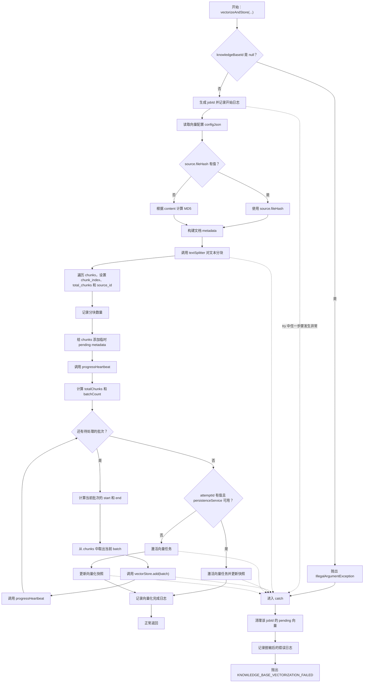
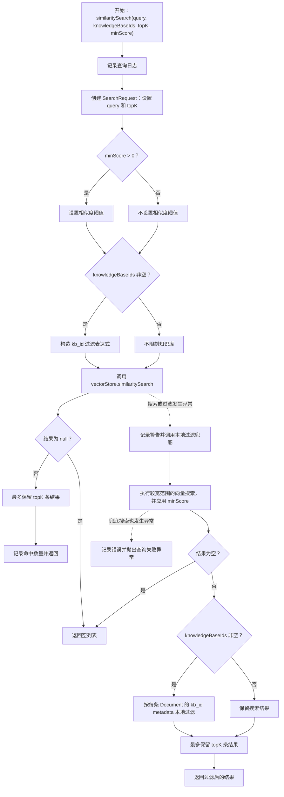

---
summary:
tags:
created: 2026-11-17
updated: 2026-11-17
---
# vectorAndStore

函数职责是将数据库文本切成小块，逐批生成向量并写入向量库
分块使用的是TextSplitter
首先将文本分块，然后为每个文本添加元数据进行标识，标识完成之后要分批向量化处理，之后是所有chunks写入向量库后，如何从临时数据编程数据库正式数据
`add` 是**把新向量放进去**；后续数据库操作是**确认新数据可用、替换旧数据并更新知识库状态**。把两步分开，处理期间旧向量仍可检索；若生成失败，也能按 `jobId` 清理新写入的临时数据。

如何理解所谓正式向量呢？
它们都存放在 `vector_store` 中，主要靠 metadata 区分“待发布”和“正式可用”。
重新向量化时的过程是：
1. 开始处理：旧的正式向量继续可用；新生成的向量写入同一个向量表，但 `kb_id` 暂时是 `pending:知识库ID:jobId`，表示它们还未发布。
2. 处理成功：删除旧的正式向量，把这批 pending 向量的 `kb_id` 改成正式知识库 ID，并移除临时标记。
3. 处理失败：按 `jobId`（UUID随机生成的） 删除本次 pending 向量，旧的正式向量保留。
因此“正式 / 非正式”是对可检索状态的简化说法：非正式向量就是待发布的临时向量。它们的正文和 Embedding 已经写进向量库，但正常按知识库 ID 检索时还匹配不到。

# similaritySearch和similaritySearchFallback

基于多个数据库进行相似度搜索
具体流程很简单就是构造条件，然后执行查询操作，判断是否为空就行，如果不为空就限制数量，如果为空就返回空集合，返回的结果是Ducument类型的，这个也能理解，因为我们存入向量数据库的就是分段的ducument
第二个函数相当于兜底函数