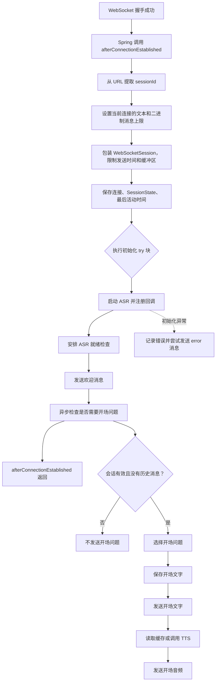
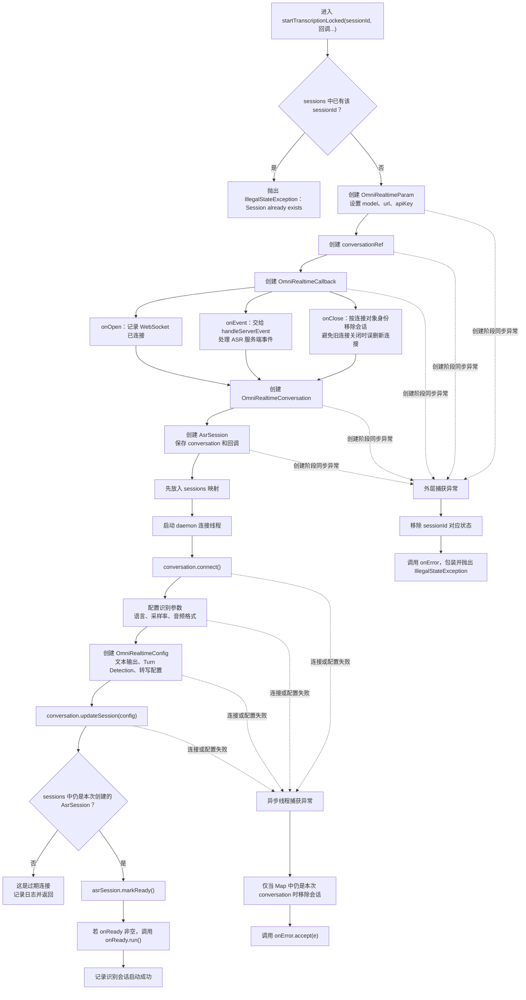
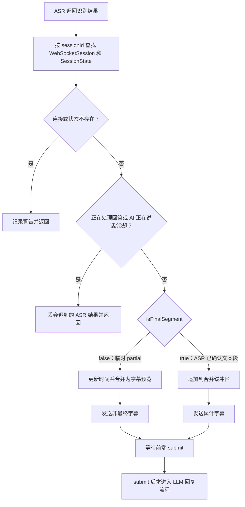
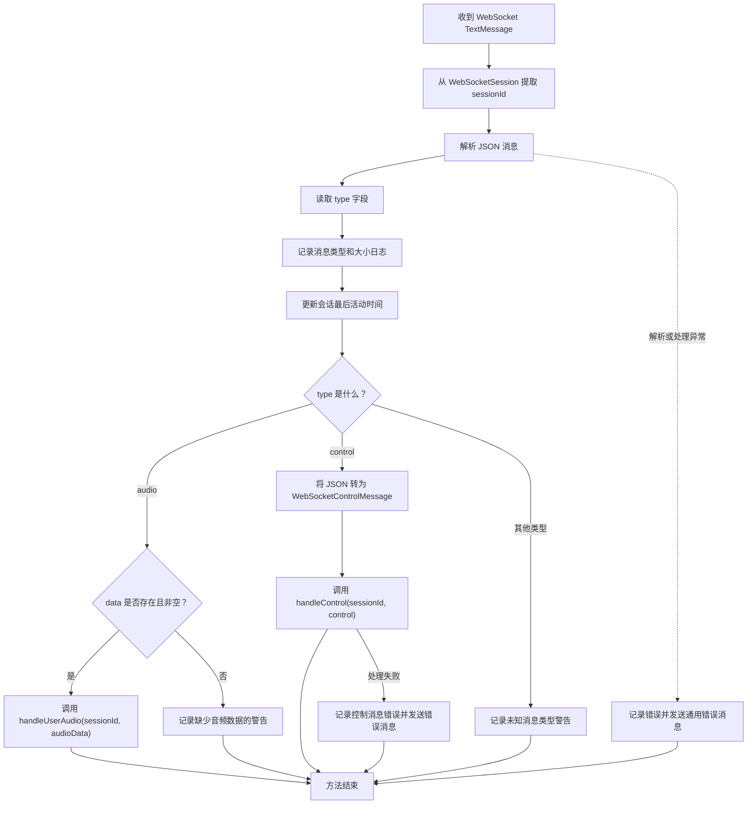
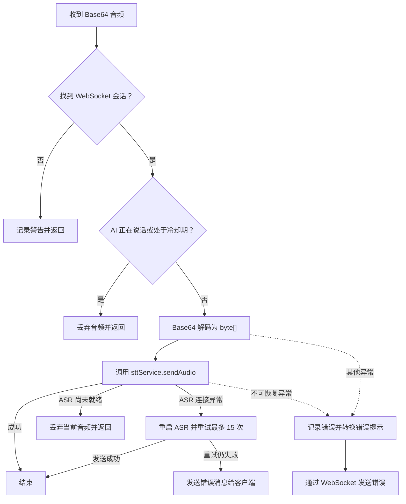
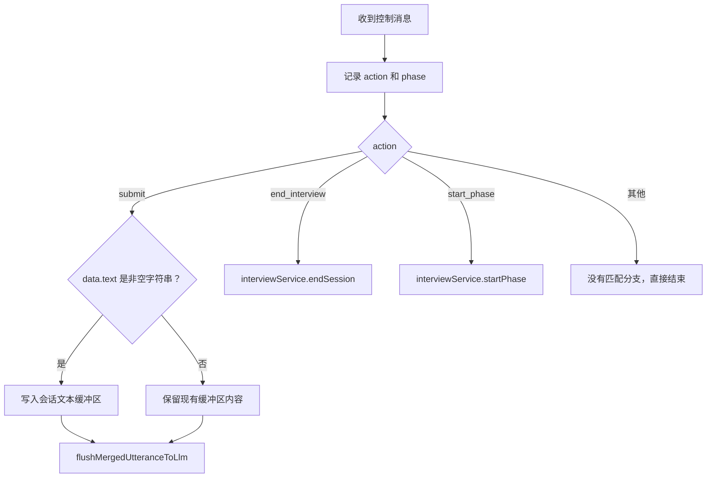
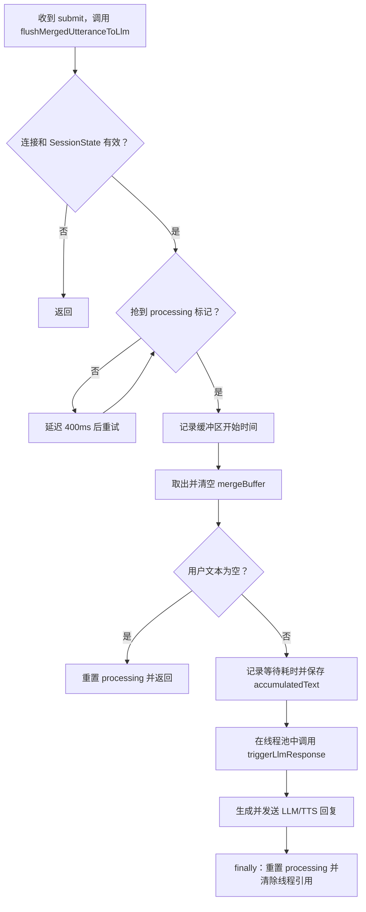
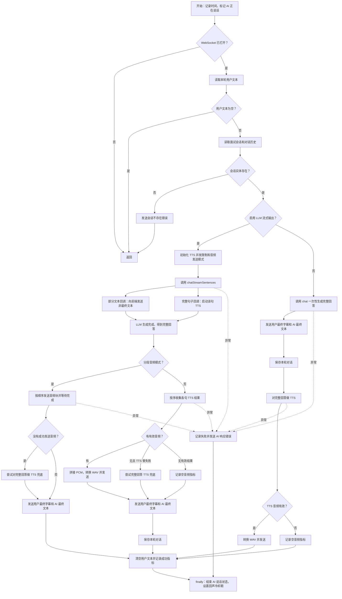
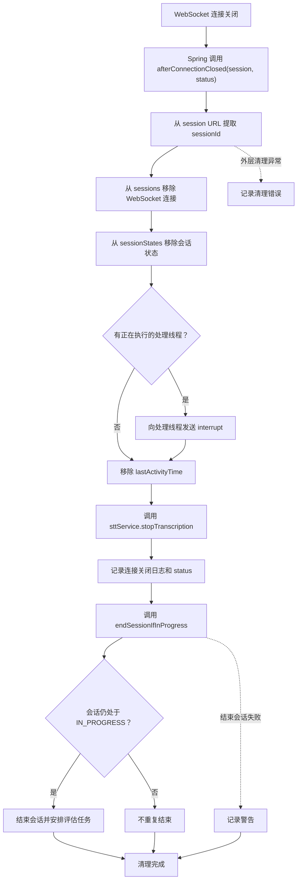
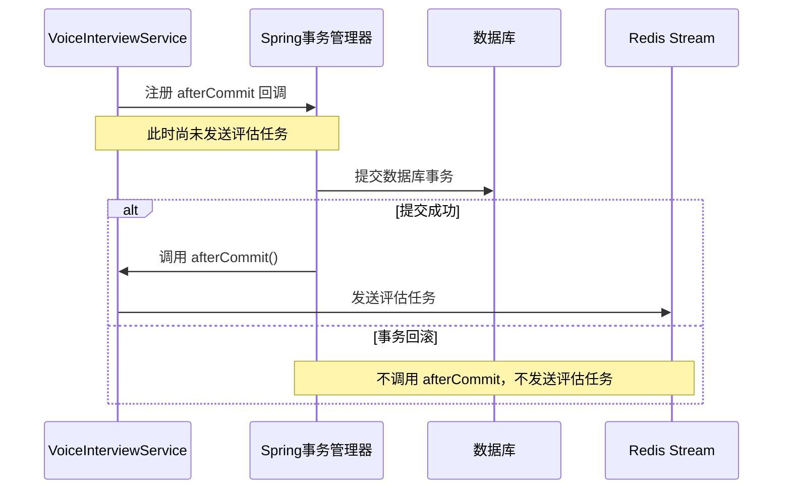

---
summary:
tags:
created:
updated:
---
相关网址：

相关笔记：
[[WebSocket]]

---
拦截器建立也需要配置，配置的话要参考WebSocketConfig，但是配置还是比较简单的。拦截器的内容在SpringMVC中，如果想了解可以前往
有关WebSocket的相关知识可以前往[[WebSocket]]了解，那么这个项目是如何建立WebSocket连接的呢？拦截器又在哪些地方发挥了作用呢？
```
1. 前端 POST 创建面试
   ← 后端返回 sessionId
2. 前端用 sessionId 调用 new WebSocket(url)
   → 浏览器发送带 Upgrade 头的 HTTP 握手请求
3. WebSocket 握手拦截器运行
   → Spring 检查并处理握手
   ← 成功时返回 HTTP 101 Switching Protocols
4. WebSocket 连接建立
   → Handler 的 afterConnectionEstablished() 被调用
5. 之后客户端发来的 WebSocket 消息
   → Handler 的 handleTextMessage() 处理
```
# afterConnectionEstablished

ASR:自动语音识别
## startDashScopeStt
为一个面试会话自动DashScope语音识别，并设置识别结果和连接状态的回调
这个事务中调用了一个创建并连接DashScope、实时语音识别绘画，配置识别参数，本身还没有发送用户音频，连接准备后其他代码通过这个ASR会话发送音频

这个函数还是比较复杂的，但是从黑盒的角度看这个函数，其为当前面试打开语音识别通道，让系统能够听懂用户的话。它负责听和把语音转成文本。DashScope是阿里云提供的模型服务平台。
在后续用户提交识别出的文字后，项目调用大语言模型生成AI回复，把回复念出来的时候再次调用TTS服务
### handleSttResult
每当语音识别服务返回一段识别结果，它就被调用。它要区分**识别中的临时文本**和**ASR 已确认的文本段**。

## sendMessage
发送信息，这个函数也很简单，主要是检查WebSocket是否仍在处于连接
## triggerOpeningQuestionIfNeeded
这里使用了虚拟线程，但是并没有创建虚拟线程池
```
private final ExecutorService voicePipelineExecutor =
    Executors.newVirtualThreadPerTaskExecutor();
```
关键在于 `PerTask`：每提交一个任务，执行器就创建一个新的虚拟线程来运行它；任务结束后，线程也结束。它**不会像固定大小的线程池那样复用一批工作线程**。
那么为什么使用虚拟线程呢？执行器用于把 LLM、TTS 等可能阻塞的工作放到虚拟线程上运行，避免占住专门负责调度的线程；例如开场语音处理和用户提交后触发的回答流程都会提交任务。**每个语音处理任务使用一个虚拟线程；执行器负责接收和管理这些任务，但不维护一池供任务复用的虚拟线程。**
除此之外这里面还有一些比较有趣的问题
在调用完buildOpeningQuestion之后会把开场问题按照文字->语音的顺序发送给前端
首先落库，然后发送给前端文字（这里后端给前端发送文字使用的是WebSocketSession中的sendTextMessage方法

在语音方面，首先获取对应话的WAV音频，这里需要使用Redis，如果Redis没有就要使用异步方法将text转为Wav，然后放入Redis中，至于如何转的呢？这里使用的是QwenTtsService的一个方法获得pcm字节数组，然后又使用了convertPcmToWav方法
### buildOpeningQuestion
根据当前的skillId,选择一条预先配置好的开场问题。不调用LLM，按优先级配置。可能开场的问题是一个算法问题也可能是一个后端项目问题
### convertPcmToWav
这个方法将千问得到的pcm字节数组转换为WAV格式的，这个方法只添加了文件头，没有转换或者重采样音频，因此它要求传入的 `pcmData` 本身确实是 **24 kHz、16 bit、单声道 PCM**。
### sendAudio
这个方法把 WAV 音频包装成 JSON 文本，通过 WebSocket 发给前端。
```
"type", "audio",  
"data", base64Audio,  
"text", text
```
返回的格式是这样的，base64Audio则是对应的音频数据
# handleTextMessage

这个方法是WebSocket框架的回调方法Spring 收到消息并分发给已注册的处理器；由于它是文本消息，框架就会调用你的 `handleTextMessage()`。
当前handler继承TextWebSocketHandlerSpring接收文本真会调用这个方法，这个父类默认是拒绝二进制帧的，如果要同时处理文本而二进制可以继承AbstractWebSocketHandler
## handleUserAudio
接收一段客户端发来的 Base64 音频，解码后转发给 ASR 语音识别服务，并在 ASR 暂时不可用时尝试恢复连接

### 调用QwenAsrService的sendAudio
这里的方法和上面的方法不同，上面方法的方向是AI->前端，将AI生成转换的Base64通过WebSocket发送给浏览器
这个方法是用户->ASR，检查ASR会话是否就绪，把用户音频发给语音识别服务
## handleControl
负责处理客户端发来的**控制类 WebSocket 消息**。它根据 `action` 字段分流，当前支持 `submit`、`end_interview` 和 `start_phase`

### flushMergedUtteranceToLlm
**用户提交回答后，取出当前累计的识别文本，并启动 LLM 回复流程**。它本身不生成回答；后续由 `triggerLlmResponse()` 调用 LLM、TTS 并发送回复。


#### triggerLlmResponse
读取用户提交的文本和历史记录，调用 LLM，再把文字和 TTS 音频发回前端。它支持**流式**和**非流式**两种 LLM 调用方式。

这里需要非常注意流式回答打开的情况
其通过两个回调把生成过程交给本方法处理，
1.收到文本时，调用sendTextMessage把正在生成的内容逐步发送给前端
2.识别到完整句子时：立即启动该句的TTS。最多同时合成多少句由Semaphore控制，避免并发过多
TTS又又两种发送方式
如果打开`OrderedTtsChunkEmitter`按句合成并按顺序像前端发送音频块。等待完成后，如果一块音频快都没发出就尝试把问题重新回答一次兜底
如果不分段则每个句子在TTS后台并发执行。等待LLM生成回答后，按句子顺序收集TTS结果：1.有有效结果：拼接 PCM、加 WAV 文件头，再发送完整音频2.句子级 TTS 全部失败：尝试对完整回答做一次兜底合成3.- 没有可用音频：记录空音频指标。
LLM全文生成结束之后方法还会发送一条最终文本，保存用户发言和AI回复

非流式回答
当流式开关关闭时，调用 `llmService.chat(...)` 一次性生成完整回答，然后：
1. 发送用户最终字幕和 AI 完整回答文本。
2. 保存本轮对话。
3. 对完整回答调用 TTS。
4. 若音频有效，转换成 WAV 并发送；若为空，记录指标

正常完成后，清空本轮用户文本，记录本轮耗时和完成计数。
如果过程中发生异常，方法会记录失败指标，并在连接仍打开时给前端发送错误消息。
`finally` 中无论成功、异常还是提前返回，都会：
- 将 `aiSpeaking` 设回 `false`。
- 设置 AI 播放结束后的 800 毫秒冷却时间，防止回声立即进入 ASR。
##### chatStreamSentences
# afterConnectionClosed

`afterConnectionClosed()` 是 Spring WebSocket 的生命周期回调。连接关闭后，Spring 会调用它；参数 `status` 表示连接关闭状态。这个项目用它清理与该 WebSocket 连接关联的内存状态、停止 ASR，并处理面试会话的结束逻辑
## 调用QwenAsrService的stopTranscription
停止ASR
## 调用VoiceInterviewService的endSessionIfInProgress
尝试结束仍在进行中的面试
这个函数还是值得看一下的，首先就是数据库查询查找到SEssion实体，然后设置一些参数保存还要将这个会话从Redis中删除
除此之外还需要调用sendEvaluateTaskAfterCommit
### sendEvaluateTaskAfterCommit
这个也是QwenAsrService类里面的，主要作用是向消息队列中添加一个分析的任务，

if判断主要是检查当前线程有没有启用Spring事务同步机制，如果没有则立即执行发送任务。如果启动了事务同步则要注册一个事务回调，事务成功提交后，Spring 执行 `afterCommit()`，这时才真正发送评估任务。若事务回滚，`afterCommit()` 不会被调用，因此不会发送任务。