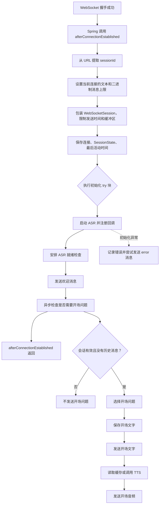

---
summary:
tags:
created:
updated:
---
相关网址：

相关笔记：
[[WebSocket]]

---
拦截器建立也需要配置，配置的话要参考WebSocketConfig，但是配置还是比较简单的。拦截器的内容在SpringMVC中，如果想了解可以前往
有关WebSocket的相关知识可以前往[[WebSocket]]了解，那么这个项目是如何建立WebSocket连接的呢？拦截器又在哪些地方发挥了作用呢？
```
1. 前端 POST 创建面试
   ← 后端返回 sessionId
2. 前端用 sessionId 调用 new WebSocket(url)
   → 浏览器发送带 Upgrade 头的 HTTP 握手请求
3. WebSocket 握手拦截器运行
   → Spring 检查并处理握手
   ← 成功时返回 HTTP 101 Switching Protocols
4. WebSocket 连接建立
   → Handler 的 afterConnectionEstablished() 被调用
5. 之后客户端发来的 WebSocket 消息
   → Handler 的 handleTextMessage() 处理
```
# afterConnectionClosed

ASR:自动语音识别
## startDashScopeStt
