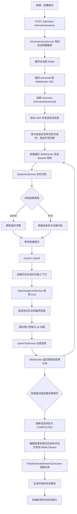

---
summary:
tags:
created: 2026-11-23
updated: 2026-11-23
---
相关网址：

相关笔记：
[[WebSocket]]

---


# 问题
可能出现的名词的解释
ASR
TTS
LLM 调用语言模型生成文本
## 为何使用WebSocket
语音面试是双向实时交互，前端要持续上传音频，后端要持续推送字幕、AI文本和音频片段。普通的http请求更适合一次请求一次响应。WebSocket则适合长连接、双向通信
## VoiceInterewWebSocketHandler到底是干啥的？
这个函数负责的东西很多，比如控制连接简历之后、连接结束、拦截并处理文本。
### 虚拟线程
其中使用了虚拟线程，如果对虚拟线程有问题则可以参考[[虚拟线程]]。其使用虚拟线程来完成LLM、TTS、数据库这类可能阻塞的工作，避免占满调度线程。对于虚拟线程的挂载和卸载操作我之前理解感觉有一些误区。或者说不知道虚拟线程到底是什么意思...
### WebSocket建立连接之后
建立连接之后会封装WebSocket会话存入到ConcurrentHashMap确保安全，并且会打开ASR服务，让系统能够听懂用户说的话。负责把听和语音转换为文本
并发送欢迎消息（使用sendMessage函数）
使用方法构建完成回答之后落库并发送给前端然后会使用一个异步方法将回答使用ttsService.synthesize(text)经过AI之后将文本变成WAV数据，然后转换为pcm数据，并发送给前端
### 在连接过程中如何进行处理的
使用handleText来处理文本信息
handleUSerAudio这个函数用来处理客户端发来的Base64音频，解码后转发给 ASR 语音识别服务，并在 ASR 暂时不可用时尝试恢复连接（这个操作是将用户的语音解码之后给AI）。这里面就有一个AI的回音处理机制（使用了ConcurrentHashMap，状态量设置为一个Concurrenthashmap），处理之后有一个回调的过程...晕晕晕...
handleControl 前端提交答案还要按下提交按钮。前端提交的数据实际上有type也有action。这个按钮会提交、结束面试
这里需要注意语音如何从前端到LLM的流程
如果提交就使用flushMergedUtteranceToLlm这个方法处理（会获取state的文本），如果没文本就返回，有文本就调用triggerLlmResponse（这里有数据库的保存操作保存用户文本和LLM生成文本。流式生成的落库时机是流式生成完毕之后）。这里分为流式回复和非流式回复
### WebSocket连接结束之后
停止ASR、首先就是数据库查询查找到SEssion实体，然后设置一些参数保存还要将这个会话从Redis中删除。除此之外还需要调用sendEvaluateTaskAfterCommit主要作用是向消息队列中添加一个分析的任务，

### 一些修正
```
1. **`handleUserAudio()` 不会直接把语音交给 LLM。**它解码 Base64 后调用 `sttService.sendAudio()`，把音频送给 ASR。ASR 识别结果之后通过回调进入 `handleSttResult()`：临时结果更新字幕，确认文本段则合并到 `SessionState`。
    
2. **停顿或 ASR 确认一段文本，不等于提交回答。**前端把字幕放进可编辑的 `userText`；用户点击“提交回答”时，才发送 `type=control, action=submit`。后端收到后调用 `flushMergedUtteranceToLlm()`。
    
3. **虚拟线程负责承载可能阻塞的工作。**`execute()` 把任务交给虚拟线程执行，WebSocket 回调线程不必等待整个 LLM/TTS 流程。虚拟线程调用同步的 TTS 时仍会等待结果；等待期间它可以暂停并释放底层平台线程，收到结果后再恢复。
    
4. **TTS 音频格式的顺序是 PCM → WAV。**`ttsService.synthesize()` 返回 PCM；`convertPcmToWav()` 给 PCM 加 WAV 文件头，再发给前端。不是把 WAV 转回 PCM。
    
5. **流式回答的顺序要稍作补充。**LLM 生成过程中，部分文本会逐步发给前端，完整句子也可能提前启动 TTS。等完整 LLM 回答生成后，代码保存用户文本和 AI 回答；随后再等待或收集 TTS 结果并发送音频。因此落库不必等全部音频发送完。
    
6. **连接关闭时不只是删除 Redis 缓存。**Handler 会移除内存里的连接、状态和活动时间，尝试中断处理线程并停止 ASR；接着调用 Service 检查并结束仍在进行中的会话。Service 更新会话状态、使 Redis 缓存失效，并在事务提交后投递评估任务。
```